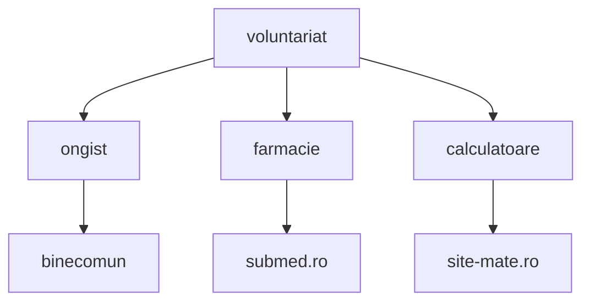

# Lucrător de tineret x programator
## Proiecte web pentru comunitatea ONG-urilor

|Proiect    | Comunitatea |
|-----------|-------------|
|[Bine comun](https://mrpaulescu.github.io/youth.suceava/) |Tineri și ong-uri din Suceava|
|[Submed.ro](submed.ro) |candidații la admiterea facultăților de medicină din România         |
|site-mate.ro (în lucru)|Studenții care vor să învețe mate pentru facultate|

## De ce?

1. 2 ani experienta ca lucrator de tineret
2. 4 ani de coordonat voluntari
3. 5 proiecte manageriate
4. 4 initiative validate de comunitate
    1. Capitala Tineretului din Romania Suceava 2028
    2. submed.ro
    3. Federatia Tinerilor din Suceava(in proces de oficializare)
